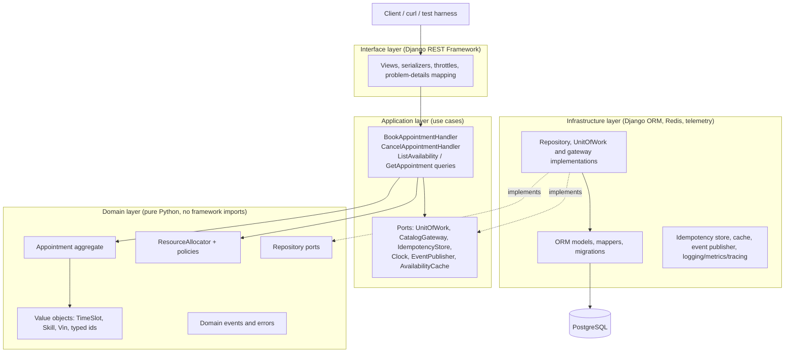

# Spec: Unified Service Scheduler (Scenario A) — Django Backend

**Version 1.0 — FINAL, ready for implementation.**

> Single source of truth for implementation (feed to oh-my-claudecode / Claude Code) and the basis for the System Design Document.
> Layer chosen: **Backend** (RESTful API + persistent DB). Client is stubbed via OpenAPI spec + curl examples.
> Stack: **Python 3.12, Django 5, Django REST Framework, PostgreSQL 16.**

---

## 0. Instructions for the implementing agent (read first)

**Mission:** implement this spec milestone by milestone (§12). The spec is authoritative; §14 holds the concrete details (IDs, error codes, examples, seed data, env vars, commands).

**Working agreement**
1. Work on **one milestone at a time**. After each, stop and report: what was built, tests/linters run and their results, and any assumption you made that is not in this spec.
2. **Do not change** assumptions (§2), stack (§3), layering rules (§4.2) or DB constraints (§5) without asking. If something is ambiguous, choose the simplest option, state it in your report, and record it in `docs/DECISIONS.md`.
3. **Tests first** for domain and application code (TDD). No behaviour without a test.
4. Before declaring a milestone done, run: `ruff check`, `mypy`, `pytest`, `lint-imports`. **Never** weaken a test, delete a failing test, or edit `.importlinter` to make a check pass; fix the code instead.
5. The domain layer must not import Django or DRF, and business rules must live in the domain, not in views, serializers or ORM models.
6. Use plain classes and constructor injection. No generic base repositories, event-bus libraries or DI frameworks (§4.7).
7. One git commit per milestone with a clear message. Never commit secrets; configuration comes from environment variables (§14.6).
8. Append an entry to `docs/AI_LOG.md` per milestone (§13): intent, what you produced, how it was verified, what was corrected.

**Out of scope (do not build):** authentication/authorisation, payments, notifications, rescheduling, technician shifts/leave, public CRUD for reference data, any frontend UI, multi-capacity bays.

**Deliverables checklist (assessment)**
- [ ] `docs/SYSTEM_DESIGN.md`: architecture diagram, component roles, data flow, technology justifications, observability strategy, GenAI-in-design section, assumptions (§2), decisions D1–D5 (§4.6)
- [ ] Working Django backend with PostgreSQL persistence and REST API
- [ ] `README.md`: how to build, run, test; **AI Collaboration Narrative** section
- [ ] Test suite covering §7 criteria, concurrency, constraints, architecture rules
- [ ] `docs/openapi.yaml` and `docs/curl-examples.md` (stubbed client)
- [ ] Load-test results recorded in README (§2.1 targets)

## 1. Goal

Replace manual booking with an API that confirms a service appointment **only if** a Service Bay **and** a qualified Technician are both free for the **entire** service duration, then persists an Appointment linking customer, vehicle, technician and bay.

## 2. Assumptions (copy into the SDD)

| # | Assumption | Rationale |
|---|-----------|-----------|
| A1 | Auth is out of scope; the caller supplies `customer_id`. Reference data (dealerships, service types, bays, technicians, customers, vehicles) is seeded via a management command and managed through Django Admin, not the public API. | Keeps focus on booking logic. |
| A2 | Each ServiceType has a fixed `duration_minutes` and one `required_skill`. A technician is "qualified" if they hold that skill. | Simplest meaningful qualification model. |
| A3 | A ServiceBay and a Technician each belong to exactly one dealership. | Avoids cross-site scheduling. |
| A4 | A bay hosts one appointment at a time; a technician works one appointment at a time. | Resource-constrained booking. |
| A5 | Intervals are half-open `[start, end)`; back-to-back appointments are allowed. No buffer time. | Standard interval semantics. |
| A6 | Timestamps are stored and exchanged in UTC (ISO-8601). Each dealership has an IANA timezone and daily opening hours; an appointment must fit within opening hours of a single local day. | Avoids DST bugs. |
| A7 | Start times must be in the future and aligned to 15-minute slots. | Bounded search space, clean UX. |
| A8 | A vehicle cannot have two overlapping confirmed appointments and must belong to the requesting customer. | Prevents duplicate/fraudulent bookings. |
| A9 | Assignment is automatic. Deterministic rule: least-loaded qualified technician that day, then lowest id; lowest-id free bay. | Predictable, testable. |
| A10 | Statuses: `CONFIRMED`, `CANCELLED`. Cancelling frees resources. Rescheduling (cancel + rebook) is out of scope for v1. | Scope control. |
| A11 | `POST /appointments` is idempotent via `Idempotency-Key` header (24h retention). | Safe client retries. |
| A12 | No technician shifts/breaks/leave in v1 (available during dealership opening hours). Extension point. | Scope control. |
| A13 | Traffic volumes and capacity targets are as defined in §2.1 (≈10 booking TPS / 600 per min sustained design target, 50 TPS burst; ≈100 availability TPS). | Gives concrete sizing and test targets. |
| A14 | Booking is always authoritative against the DB (real-time check). The availability *listing* endpoint may serve results up to 5 s stale from cache; the booking call still re-validates. | Lets reads scale without weakening correctness. |
| A15 | Contention is per dealership (and per slot), not global; dealerships are independent. | Justifies per-dealership hot-spot testing and future sharding by dealership. |
| A16 | Scheduling is the **core domain** and gets full DDD tactical design. Catalog (dealerships, service types, customers, vehicles) is a **supporting subdomain**: simple Django models + admin, no heavy modelling. | Spend design effort where the business logic is. |
| A17 | One deployable (modular monolith), one PostgreSQL database. Bounded contexts talk through in-process interfaces and reference each other by ID only. | Simplicity now; contexts can be split into services later. |
| A18 | A dealership has one opening window (`open_time`–`close_time`, local time) that applies every day of the week; closed days and holidays are out of scope. | Scope control. |
| A19 | An appointment can be cancelled only before its start time. Repeated cancellation is idempotent. | Simple, predictable lifecycle. |

### 2.1 Traffic & capacity assumptions

These are **assumed** figures for sizing and testing (not measured). State them in the SDD and video, and validate with the load test in §8.

**Demand model (derivation)**

| Input | Assumption |
|---|---|
| Dealerships on the platform | 500 |
| Service bays per dealership | 8 (→ 4,000 bays) |
| Operating pattern | 10 h/day, 6 days/week |
| Average service duration | 90 min |
| Utilisation booked through this system | ~4 jobs per bay per day |
| **Confirmed bookings/day** | **~16,000** |
| Booking requests/day (incl. ~25% rejected with 409) | ~20,000 |
| Cancellations/day (~15% of bookings) | ~2,400 |
| Availability lookups/day (~10 per booking attempt) | ~200,000 |
| Peak-hour share of daily traffic | 15% |
| Burst factor (marketing campaign / recall notice) | 5× peak hour |

**Resulting load**

| Traffic | Peak hour (avg) | Expected burst | **Design target (sustained)** | **Stress target (60 s burst)** |
|---|---|---|---|---|
| Booking writes (POST) | ~0.8 TPS (50/min) | ~4 TPS (250/min) | **10 TPS (600/min)** | **50 TPS (3,000/min)** |
| Cancellations (DELETE) | ~0.1 TPS | ~0.5 TPS | 2 TPS | 10 TPS |
| Availability reads (GET) | ~8 TPS (500/min) | ~40 TPS (2,500/min) | **100 TPS (6,000/min)** | **500 TPS (30,000/min)** |

Design target ≈ 2.5× the expected burst, which also covers ~3× growth over two years.

**Service-level targets**

| Metric | Target |
|---|---|
| Booking latency | p95 < 300 ms, p99 < 800 ms at design target |
| Availability latency | p95 < 150 ms (cache hit < 30 ms) |
| 5xx error rate | < 0.1% (409 conflicts are valid outcomes, not errors) |
| Availability SLO | 99.9% monthly |
| Hot-slot burst | 50 simultaneous requests for one dealership/slot → at most as many successes as free bays/qualified technicians; zero double bookings; remainder get 409 |

**Sizing implications (starting point, tune after load testing)**
- **Per-request cost:** booking ≈ 4–6 SQL statements in one short transaction (~60 ms); availability ≈ 2–3 read queries (~35 ms).
- **Web tier:** a sync gunicorn worker handles roughly 15 booking or 25–30 availability requests/s. Design target needs ~4 workers; the 500 TPS read stress needs ~17 workers *without* caching, so scale to ~4 pods × 4 workers and cache availability (A14) to cut DB reads sharply.
- **Database:** one PostgreSQL primary (4 vCPU / 16 GB) comfortably exceeds 50 write TPS; the limit is lock contention on hot slots, not raw throughput. Read replica for availability if reads grow. Use PgBouncer with ≤ 50 server connections.
- **Backpressure:** DRF throttling (e.g. 60 booking requests/min and 120 availability requests/min per customer), DB statement timeout (2 s), retry cap of 3 with jittered backoff (10–50 ms) on exclusion violations.
- **Scale-out path:** stateless web tier scales horizontally; if one primary is outgrown, shard by dealership (A15).

## 3. Tech stack

| Concern | Choice | Why |
|---|---|---|
| Framework | Django 5 + Django REST Framework | Mature, batteries-included ORM, migrations, admin |
| DB | PostgreSQL 16 (`psycopg` 3) | Range types + exclusion constraints give **DB-level** no-double-booking |
| Constraints | `django.contrib.postgres` `ExclusionConstraint` + `BtreeGistExtension` | Native Django support, version-controlled in migrations |
| OpenAPI | `drf-spectacular` | Generates the API contract for the stubbed client |
| Tests | `pytest` + `pytest-django` (+ `factory_boy`) against real Postgres | Concurrency tests need a real DB |
| Logging | `structlog` (JSON) + correlation-id middleware | Structured, traceable logs |
| Metrics | `django-prometheus` | RED metrics + custom counters at `/metrics` |
| Tracing | OpenTelemetry (`opentelemetry-instrumentation-django`, `-psycopg`) | Vendor-neutral spans |
| Serving | `gunicorn` (+ `uvicorn` workers optional) | Production-style runtime |
| Quality | `ruff`, `mypy` (django-stubs), GitHub Actions | CI quality gate |
| Load testing | `Locust` (or k6) | Validates the §2.1 TPS and latency targets |
| Caching | Django cache (Redis in compose; locmem in tests) | 5 s TTL for availability listings (A14) |
| Architecture tests | `import-linter` (run in CI) | Mechanically enforces the DDD dependency rule, including on AI-generated code |
| Wiring | Hand-written composition root (`container.py`) | Plain dependency injection; no DI framework needed |
| Packaging | Docker + docker-compose (web, postgres, otel-collector, prometheus) | One-command run |
| Deps | `uv` or `pip-tools` with pinned lockfile | Reproducible builds |

## 4. Architecture (Domain-Driven Design, layered)

### 4.1 Strategic design: bounded contexts

| Context | Type | Responsibility |
|---|---|---|
| **Scheduling** | Core domain | Availability, allocation of bay + technician, appointment lifecycle, all booking rules |
| **Catalog** | Supporting subdomain | Reference data: dealerships (timezone, hours), service types (duration, required skill), customers, vehicles. Seeded and managed via Django Admin |

Scheduling reads Catalog only through a `CatalogGateway` port (an anti-corruption layer) that returns Scheduling's own value objects, never Catalog's Django models. Scheduling stores catalog references as IDs.

**Ubiquitous language** (use these exact names in code, tests, API and docs):

| Term | Meaning |
|---|---|
| Appointment | A confirmed reservation of one bay and one technician for one vehicle over a time slot |
| Service Type | A kind of work with a fixed duration and a required skill |
| Service Bay | Physical workspace at a dealership; hosts one appointment at a time |
| Technician | Person who performs work; holds skills; works one appointment at a time |
| Skill | Qualification a technician holds and a service type requires |
| Time Slot | Half-open interval `[start, end)`, UTC |
| Opening Hours | Dealership's local daily window within which a slot must fit |
| Allocation | Choosing the bay and technician for a requested slot (rule A9) |

### 4.2 Layers and the dependency rule

Dependencies point inward only: Interface → Application → Domain. Infrastructure implements ports defined by the Domain and Application layers (dependency inversion).



| Layer | Contains | May import | Must not import |
|---|---|---|---|
| Domain | Aggregates, entities, value objects, domain services, policies, events, errors, repository ports | Python stdlib, `shared_kernel` | Django, DRF, application, infrastructure, interface |
| Application | Command/query handlers, DTOs, ports (UnitOfWork, gateways), cross-cutting decorators | Domain, `shared_kernel` | Django, DRF, infrastructure, interface |
| Infrastructure | ORM models, mappers, repository/UoW implementations, adapters (cache, idempotency, catalog) | Domain, Application, Django, third-party libs | Interface |
| Interface | DRF views, serializers, URL routing, throttles, error-to-HTTP mapping | Application (via `container.py`) | Domain internals beyond DTOs/errors, ORM models |

`container.py` is the composition root: it builds infrastructure adapters and injects them into handlers. Views obtain handlers from it.

### 4.3 Tactical design (Scheduling domain)

- **Aggregate root `Appointment`:** holds ids of customer, vehicle, dealership, service type, bay, technician, plus `TimeSlot` and `status`. Behaviour: `Appointment.schedule(...)` (factory that records `AppointmentConfirmed`) and `cancel()` (rejects if already cancelled, records `AppointmentCancelled`). It enforces its own invariants (non-empty slot, valid state transitions). It exposes `pull_events()`.
- **Entities:** `ServiceBay(id, dealership_id, name)`, `Technician(id, dealership_id, name, skills)`.
- **Value objects (immutable):** `TimeSlot` (overlap, contains, duration), `Skill`, `Vin`, typed ids (`AppointmentId`, `BayId`, `TechnicianId`, ...), `AppointmentStatus`.
- **Domain service `ResourceAllocator`:** given free bays and qualified free technicians (with each technician's load that day), applies rule A9 and returns an allocation or raises `NoCapacityAvailable`. Pure and deterministic.
- **Policies (specification objects):** `SlotAlignmentPolicy` (15-minute grid, future time, A7), `OpeningHoursPolicy` (fits in one local day within hours, DST-safe, A6).
- **Domain errors:** `NoCapacityAvailable`, `OutsideOpeningHours`, `InvalidSlot`, `VehicleAlreadyBooked`, `VehicleNotOwnedByCustomer`, `AppointmentAlreadyCancelled`, `ResourceConflict` (raised by infrastructure when the DB rejects an overlap).
- **Domain events:** `AppointmentConfirmed`, `AppointmentCancelled`. Dispatched in-process **after commit**; a transactional outbox is the documented future step.
- **Repository ports (domain):** `AppointmentRepository` (`add`, `get`, `vehicle_has_overlap`), `ResourceRepository` (`find_available_bays`, `find_available_technicians`).

### 4.4 Application layer

- **Commands:** `BookAppointmentHandler`, `CancelAppointmentHandler`. Each takes a command DTO, runs inside a `UnitOfWork`, and returns a result DTO.
- **Queries (CQRS-lite):** `ListAvailability` and `GetAppointment` read through dedicated read-model ports, bypassing aggregates. This keeps the read path fast and cacheable (A14).
- **Ports:** `UnitOfWork` (exposes repositories, `commit`/`rollback`), `CatalogGateway`, `IdempotencyStore`, `Clock`, `EventPublisher`, `AvailabilityCache`.
- **Cross-cutting via decorators:** `idempotent(...)`, `logged_and_measured(...)`, applied in the composition root so handlers stay focused on the use case.
- **Retry policy:** owned here. `BookAppointmentHandler` retries up to 3 times with jittered backoff when infrastructure raises `ResourceConflict`.

### 4.5 Data flow (book appointment)

1. **Interface:** DRF serializer validates the payload; view builds `BookAppointmentCommand` and calls the handler (wrapped by idempotency + logging/metrics decorators).
2. **Application:** loads `ServiceOffering`, dealership calendar and vehicle ownership through `CatalogGateway`; asks the domain for a `TimeSlot` and runs `SlotAlignmentPolicy` and `OpeningHoursPolicy`.
3. **Application (inside `UnitOfWork`):** checks `vehicle_has_overlap`; fetches free bays and qualified free technicians via `ResourceRepository`; calls `ResourceAllocator`; builds the aggregate with `Appointment.schedule(...)`; `appointments.add(...)`.
4. **Infrastructure:** the repository maps the aggregate to the ORM model and inserts it. An exclusion violation (SQLSTATE `23P01`) is translated to the domain's `ResourceConflict`.
5. **Application:** on `ResourceConflict`, roll back and retry from step 3 (max 3), else raise `NoCapacityAvailable`. On success, commit, publish events, return the result DTO.
6. **Interface:** maps result to `201`, and domain errors to `409`/`422`/`404` problem-details responses.

### 4.6 Key design decisions (include in the SDD)

| # | Decision | Rationale / trade-off |
|---|---|---|
| D1 | `Appointment` is the only aggregate; bays and technicians are separate entities, and "no overlap" spans many appointments | A per-dealership "Schedule" aggregate would serialise every booking for a dealership and create the hot-spot contention §2.1 wants to avoid. Instead the allocator pre-checks and the database enforces the invariant. |
| D2 | Exclusion constraints are the final guard for resource exclusivity | Under concurrency, in-memory domain checks alone can race. The DB constraint is the single source of truth; the domain pre-check gives good errors and the common fast path. |
| D3 | Domain objects are separate from Django ORM models, connected by mappers | Keeps the domain framework-free and unit-testable; cost is mapping code. Catalog (supporting) skips this and uses Django models directly. |
| D4 | Modular monolith with ID-only references between contexts | Low operational cost now; clean seam to split later (A17). |
| D5 | CQRS-lite: reads bypass aggregates | Availability reads dominate traffic (10:1) and must be cached and fast. |

### 4.7 Guardrails (against over-engineering and layer leaks)

- No generic base repositories, event-bus libraries or DI frameworks; plain classes and constructor injection.
- Domain code never imports Django; `import-linter` fails CI if it does (contracts in §8).
- Keep handlers thin and behaviour in the domain: avoid an anemic model where the aggregate is just a data bag.
- Do not model Catalog as a rich domain; it is deliberately simple CRUD.

## 5. Domain model and persistence model

**Domain model (Scheduling, pure Python):**

```
Aggregate root  Appointment(id, customer_id, vehicle_id, dealership_id, service_type_id,
                            bay_id, technician_id, slot: TimeSlot, status, created_at, cancelled_at)
Entities        ServiceBay(id, dealership_id, name)
                Technician(id, dealership_id, name, skills: frozenset[Skill])
Value objects   TimeSlot(start, end) | Skill | Vin | typed ids | AppointmentStatus
Domain service  ResourceAllocator
Policies        SlotAlignmentPolicy, OpeningHoursPolicy
Events          AppointmentConfirmed, AppointmentCancelled
```

**Persistence model (Django ORM).** Scheduling tables live in `contexts/scheduling/infrastructure/persistence/models.py` (a Django app of its own); Catalog tables in `contexts/catalog/models.py`. Mappers translate between ORM rows and domain objects.

```
Dealership(name, timezone, open_time, close_time)
Customer(name, email unique)
Vehicle(customer FK, vin unique, make, model, year)
ServiceType(name, duration_minutes, required_skill)
ServiceBay(dealership FK, name)
Technician(dealership FK, name)
TechnicianSkill(technician FK, skill)   # unique (technician, skill)
Appointment(
  id UUID pk, customer FK, vehicle FK, dealership FK, service_type FK,
  service_bay FK, technician FK,
  time_range DateTimeRangeField (bounds "[)"),
  status CharField choices, created_at, cancelled_at
)
IdempotencyRecord(key unique, request_hash, response_status, response_body JSON, created_at)
```

**Integrity constraints (core design point, infrastructure layer)** — declared on the ORM `Appointment` model; the first scheduling migration starts with `BtreeGistExtension()`:

```python
class Meta:
    constraints = [
        ExclusionConstraint(
            name="no_bay_overlap",
            expressions=[("service_bay", RangeOperators.EQUAL), ("time_range", RangeOperators.OVERLAPS)],
            condition=Q(status="CONFIRMED"),
        ),
        ExclusionConstraint(
            name="no_technician_overlap",
            expressions=[("technician", RangeOperators.EQUAL), ("time_range", RangeOperators.OVERLAPS)],
            condition=Q(status="CONFIRMED"),
        ),
        ExclusionConstraint(
            name="no_vehicle_overlap",
            expressions=[("vehicle", RangeOperators.EQUAL), ("time_range", RangeOperators.OVERLAPS)],
            condition=Q(status="CONFIRMED"),
        ),
    ]
    indexes = [GistIndex(fields=["dealership", "time_range"])]
```

## 6. API contract (v1)

| Method | Path | Description |
|---|---|---|
| POST | `/api/v1/appointments/` | Book. Header `Idempotency-Key`. Body: `customer_id, vehicle_id, service_type_id, dealership_id, start_time` |
| GET | `/api/v1/appointments/{id}/` | Fetch appointment |
| DELETE | `/api/v1/appointments/{id}/` | Cancel (status → CANCELLED, frees resources) |
| GET | `/api/v1/availability/?dealership_id&service_type_id&date` | List bookable start times |
| GET | `/api/v1/schema/`, `/api/v1/docs/` | OpenAPI schema / Swagger UI |
| GET | `/healthz`, `/readyz`, `/metrics` | Ops endpoints |

**Responses:** `201` created · `200` ok · `400/422` validation (bad slot, past time, outside hours) · `404` unknown reference · `409` no bay/technician available, vehicle already booked, or idempotency key reused with a different payload · `500` problem JSON with correlation id.

201 body: `{ id, status, start_time, end_time, customer, vehicle, service_type, dealership, technician, service_bay }`.

## 7. Business rules (acceptance criteria)

1. Booking succeeds only when ≥1 bay AND ≥1 qualified technician in that dealership are free for the full duration.
2. If either resource is unavailable for any part of the interval → `409`, nothing persisted.
3. Success persists an appointment linking customer, vehicle, technician, bay.
4. Back-to-back bookings on the same bay/technician succeed; a 1-minute overlap fails.
5. Two concurrent requests for the last free resource: exactly one succeeds.
6. A technician without the required skill is never assigned.
7. Cancelling frees bay + technician for new bookings.
8. Same `Idempotency-Key` + same payload returns the original response with no duplicate row.
9. Vehicle must belong to the customer; unknown IDs → `404`.
10. Bookings outside opening hours or in the past → `422`.
11. `POST` without an `Idempotency-Key` header → `400`.
12. Cancelling is idempotent (repeat `DELETE` → `200`, state unchanged); cancelling at or after the start time → `422`.
13. `GET /availability` returns only start times for which a booking would currently succeed (before caching).

## 8. Testing strategy

- **Domain unit tests (`tests/unit/domain`, no DB, no Django):** `TimeSlot` overlap, policies (slot grid, opening hours incl. DST), `ResourceAllocator` (A9), aggregate behaviour and events.
- **Application tests (`tests/unit/application`):** handlers run against in-memory fakes of the ports (fake UnitOfWork, CatalogGateway, Clock); cover retry on `ResourceConflict`, idempotency and error paths without a database.
- **Architecture tests (`tests/architecture` / `lint-imports` in CI):** `import-linter` contracts: domain must not import Django, DRF, application, infrastructure or interface; application must not import Django, DRF, infrastructure or interface; interface must not import infrastructure except through `container.py`; scheduling must not import Catalog models outside `catalog_gateway.py`.
- **Infrastructure integration (`pytest-django`, real Postgres):** repositories, mappers, UoW, and translation of `23P01` into `ResourceConflict`.
- **API tests (`pytest-django`, real Postgres):** every acceptance criterion in §7 through the DRF test client.
- **Concurrency:** use `@pytest.mark.django_db(transaction=True)`; N threads each with its own DB connection (close connections at thread end) call `BookAppointmentHandler` for one remaining bay/technician; assert exactly one success, others `409`, one DB row.
- **Constraint test:** raw ORM insert of overlapping confirmed rows raises `IntegrityError` (proves the DB safety net works independent of app code).
- **Load test (Locust, `tests/load/`):** scenarios for sustained design target (10 booking TPS + 100 availability TPS for 10 min) and 60 s stress burst (50 / 500 TPS) plus a hot-slot scenario. Record p50/p95/p99, error rate, and DB connections in the README as evidence against §2.1. Run against docker-compose locally; state hardware used.
- **Contract test:** responses validate against the drf-spectacular schema.
- Coverage targets: ≥90% on `domain`, ≥85% on `application`.

## 9. Observability

- **Logs:** structlog JSON with `correlation_id, route, dealership_id, outcome`; no PII beyond ids.
- **Metrics:** `booking_requests_total{outcome}`, `booking_duration_seconds`, `booking_conflicts_total`, `booking_retries_total`, plus django-prometheus HTTP/DB metrics.
- **Tracing:** OTel spans for HTTP → handler → SQL; propagate `traceparent`.
- **Capacity signals:** requests/sec and p95 per endpoint, DB pool saturation, cache hit ratio, throttled-request count, retries per booking; alert when booking p95 > 300 ms or 5xx > 0.1%.
- **Health:** `/healthz` (process up) vs `/readyz` (DB reachable).

## 10. Build-for-the-future notes (for the SDD)

- **Scalability:** sized per §2.1; stateless web tier scales horizontally; correctness lives in DB constraints, not in-process locks. Read replica for availability queries; partition `appointments` by month at volume. Use PgBouncer for connection pooling.
- **Reliability:** idempotent writes, bounded retries, DB statement timeouts, graceful gunicorn shutdown.
- **Maintainability:** DDD layering enforced by `import-linter`, thin views, framework-free domain, typed code, versioned migrations.
- **AI-specific risk:** coding agents tend to leak ORM or DRF imports into the domain and to over-abstract; the architecture tests and the §4.7 guardrails are how you catch and prove you caught it (good narrative material).
- **Extension points:** technician shifts/leave, multi-capacity bays, buffers, rescheduling, waitlist, transactional outbox for notifications.
- **Known Django pitfalls to watch (verify the AI handles these):** `ATOMIC_REQUESTS` interplay with retries (use explicit savepoints), `IntegrityError` also covering non-overlap violations (check SQLSTATE `23P01` before retrying), timezone-aware datetimes only (`USE_TZ=True`), avoiding N+1 queries in serializers.

## 11. Repo layout

```
manage.py
config/                          # Django project: settings (base/dev/test), urls, wsgi
shared_kernel/                   # Entity/ValueObject/DomainEvent bases, ids, Clock
contexts/
  scheduling/                    # CORE domain
    domain/
      model/                     # appointment.py, resources.py, value_objects.py
      services/                  # resource_allocator.py
      policies/                  # slot_alignment.py, opening_hours.py
      events.py  errors.py  repositories.py   # repositories.py = ports
    application/
      commands/                  # book_appointment.py, cancel_appointment.py
      queries/                   # list_availability.py, get_appointment.py
      ports.py  dto.py  decorators.py
    infrastructure/
      persistence/               # Django app: models.py, migrations/, mappers.py,
                                 # repositories.py, unit_of_work.py, error_translation.py, read_models.py
      catalog_gateway.py  idempotency.py  cache.py  event_publisher.py
      telemetry/                 # structlog config, Prometheus metrics, OTel setup, middleware
    interface/
      api/                       # views.py, serializers.py, urls.py, problem_details.py, throttles.py
    container.py                 # composition root
  catalog/                       # SUPPORTING: models.py, admin.py, seed command (plain Django app)
tests/
  unit/domain/  unit/application/  infrastructure/  api/  concurrency/  load/  architecture/
docs/                            # SYSTEM_DESIGN.md, openapi.yaml, curl-examples.md
.importlinter                    # layer contracts (see §8)
docker-compose.yml  Dockerfile  pyproject.toml  README.md
```

## 12. Implementation plan (milestones for the agent)

Build inside-out: domain first, framework last.

1. **Scaffold:** Django project, DRF, settings split, Docker/compose with Postgres, `/healthz`, ruff/mypy/pytest, **`.importlinter` contracts and CI step** (so every later milestone is checked).
2. **Domain layer (TDD, zero Django imports):** value objects, `TimeSlot`, policies, `Appointment` aggregate with events, `ResourceAllocator`, errors, repository ports.
3. **Application layer with in-memory fakes:** ports, `BookAppointmentHandler` (incl. retry on `ResourceConflict`), `CancelAppointmentHandler`, DTOs.
4. **Infrastructure:** ORM models, migrations (`BtreeGistExtension`, exclusion constraints), mappers, repositories, `DjangoUnitOfWork`, `23P01` translation, `CatalogGateway` adapter, Catalog app + seed command.
5. **Interface:** DRF views/serializers, problem-details mapping, composition root, OpenAPI via drf-spectacular.
6. **Queries and remaining endpoints:** availability read model + cache (A14), get and cancel endpoints.
7. **Idempotency** (decorator + store).
8. **Observability:** logging/metrics/tracing decorators and middleware, compose collector config.
9. **Concurrency + constraint tests, then Locust load tests** against the §2.1 targets (tune workers, pool, cache TTL from results).
10. **Docs:** SDD (diagram, bounded contexts, D1-D5), curl examples, README with AI Collaboration Narrative.

Definition of done: all §7 criteria covered by passing tests; `lint-imports` passes; domain tests run with no database; `docker compose up` and the README steps work from a clean clone.

## 13. AI collaboration log (fill in as you go — graded)

For each milestone record: prompt/intent → what the AI produced → what you verified (tests, curl, code review) → what you changed and why. Include at least 2 cases where the AI was wrong or over-engineered and how you caught it.

## 14. Appendix: concrete details for implementation

### 14.1 Conventions
- **IDs:** `Appointment.id` is UUIDv4; reference entities use auto-increment integers. The domain wraps them in typed ids.
- **Time:** ISO-8601 UTC with `Z` suffix on the wire; `USE_TZ=True`; opening-hours logic converts using the dealership's IANA timezone (`zoneinfo`).
- **JSON:** `snake_case`. **VIN:** 17 characters, alphanumeric, excluding `I`, `O`, `Q`.
- **Slots:** start on the 15-minute grid, in the future; end = start + service duration.

### 14.2 Error format and mapping
Errors use `application/problem+json`: `{ "type", "title", "status", "detail", "code", "correlation_id" }`.

| Domain error | HTTP | `code` |
|---|---|---|
| Malformed/missing fields, missing `Idempotency-Key` | 400 | `validation_error` |
| Unknown dealership/customer/vehicle/service type/appointment | 404 | `not_found` |
| `NoCapacityAvailable` | 409 | `no_capacity` |
| `VehicleAlreadyBooked` | 409 | `vehicle_already_booked` |
| Idempotency key reused with a different payload, or a concurrent duplicate | 409 | `idempotency_conflict` |
| `InvalidSlot` (past, off 15-minute grid) | 422 | `invalid_slot` |
| `OutsideOpeningHours` | 422 | `outside_opening_hours` |
| `VehicleNotOwnedByCustomer` | 422 | `vehicle_not_owned` |
| Cancelling at/after start time | 422 | `cancellation_not_allowed` |
| Throttled | 429 | `throttled` |
| Unexpected | 500 | `internal_error` |

### 14.3 Request/response examples

`POST /api/v1/appointments/` with header `Idempotency-Key: 7f3c...`
```json
{ "customer_id": 1, "vehicle_id": 1, "service_type_id": 2,
  "dealership_id": 1, "start_time": "2026-11-02T09:00:00Z" }
```
`201 Created`
```json
{ "id": "5b1e8c1a-6d2f-4a35-9b0e-0f4f2f1c9a11", "status": "CONFIRMED",
  "start_time": "2026-11-02T09:00:00Z", "end_time": "2026-11-02T10:30:00Z",
  "customer": { "id": 1, "name": "Customer One" },
  "vehicle": { "id": 1, "vin": "1HGCM82633A004352" },
  "service_type": { "id": 2, "name": "Brake Service", "duration_minutes": 90 },
  "dealership": { "id": 1, "name": "Downtown Motors" },
  "technician": { "id": 2, "name": "Bob" },
  "service_bay": { "id": 1, "name": "Bay 1" } }
```
`409 Conflict`
```json
{ "type": "about:blank", "title": "No capacity", "status": 409, "code": "no_capacity",
  "detail": "No service bay and qualified technician are free for the requested time.",
  "correlation_id": "c0a8..." }
```
`GET /api/v1/availability/?dealership_id=1&service_type_id=2&date=2026-11-02` (`date` is the dealership-local day)
```json
{ "dealership_id": 1, "service_type_id": 2, "date": "2026-11-02",
  "slots": [ { "start_time": "2026-11-02T08:00:00Z", "end_time": "2026-11-02T09:30:00Z" } ] }
```

### 14.4 Availability algorithm
For the given local date, generate candidate starts every 15 minutes from `open_time` while `start + duration <= close_time`; drop starts that are in the past; keep a start only if at least one free bay **and** at least one free qualified technician exist for the whole `[start, end)`. Compute with a small number of set-based queries per request (load appointments overlapping the day once, then evaluate candidates in memory), not one query per candidate. Cache the response per `(dealership_id, service_type_id, date)` for 5 seconds (A14); invalidate on successful booking/cancel for that dealership and date.

### 14.5 Idempotency semantics
`Idempotency-Key` is required on `POST /appointments`. Store the key with a SHA-256 hash of the canonical request body and the `201` response. Same key and same hash → replay the stored response with header `Idempotent-Replayed: true`. Same key with a different hash → `409 idempotency_conflict`. The key row is written in the **same transaction** as the appointment, so a concurrent duplicate loses on the unique constraint and gets `409`. Failed requests are not stored, so clients can retry them. Expire keys after 24 hours with a management command.

### 14.6 Configuration (environment variables)
`DJANGO_SETTINGS_MODULE`, `SECRET_KEY`, `ALLOWED_HOSTS`, `DATABASE_URL`, `REDIS_URL`, `OTEL_EXPORTER_OTLP_ENDPOINT`, `BOOKING_MAX_RETRIES` (default 3), `AVAILABILITY_CACHE_TTL_SECONDS` (default 5), `IDEMPOTENCY_TTL_HOURS` (default 24), `DB_STATEMENT_TIMEOUT_MS` (default 2000). Provide `.env.example`.

### 14.7 Seed data (management command `seed_demo`; also used by tests)

| Dealership | Timezone | Hours | Bays | Technicians (skills) |
|---|---|---|---|---|
| 1 Downtown Motors | Europe/London | 08:00–17:00 | Bay 1, 2, 3 | Alice (oil_service, general), Bob (brakes, general), Chen (oil_service, brakes) |
| 2 Uptown Auto | America/New_York | 09:00–18:00 | Bay 1 | Dana (oil_service, brakes, general) |

Dealership 2 has exactly one bay and one technician so contention and concurrency tests are easy to construct. The two timezones let DST tests run.

| Service type | Duration | Required skill |
|---|---|---|
| Oil Change | 30 min | oil_service |
| Brake Service | 90 min | brakes |
| Full Service | 120 min | general |

| Customer | Vehicles (VIN) |
|---|---|
| 1 Customer One | 1HGCM82633A004352, 5YJ3E1EA7KF317000 |
| 2 Customer Two | WVWZZZ1JZXW000001 |
| 3 Customer Three | 3VWFE21C04M000001 |

### 14.8 Commands (provide a `Makefile`)
`make up` (docker compose up), `make migrate`, `make seed`, `make test`, `make lint` (ruff + mypy), `make arch` (lint-imports), `make schema` (export `docs/openapi.yaml`), `make load` (Locust).
