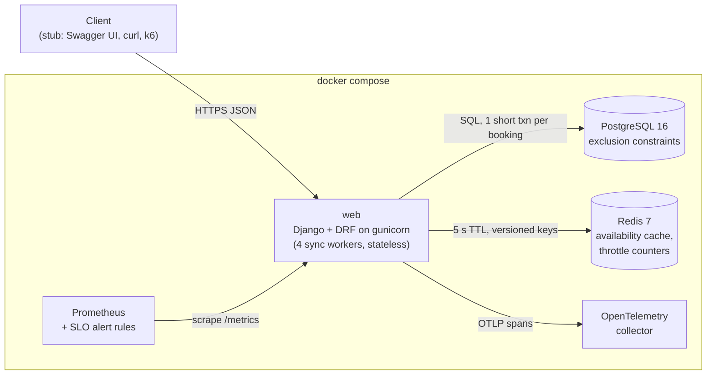
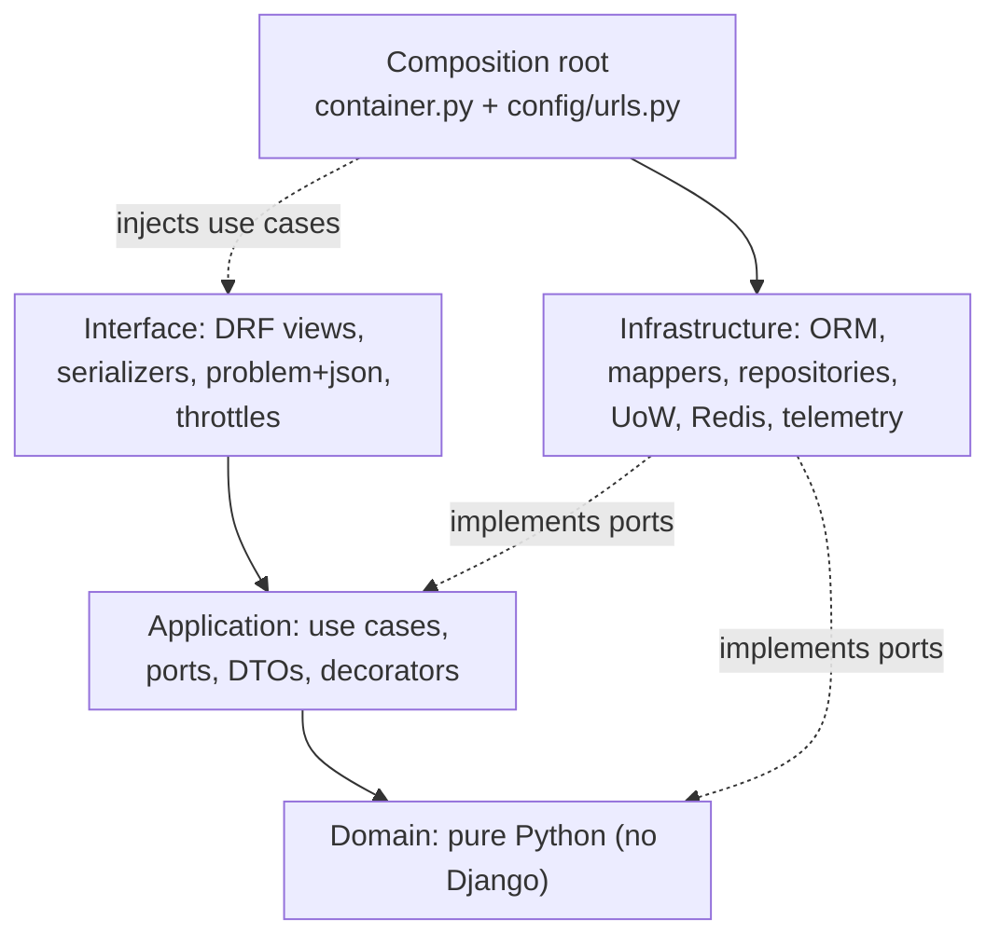
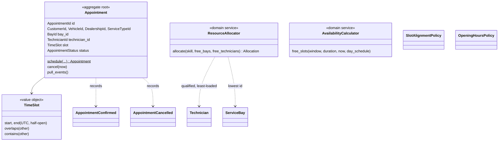

# System Design: Unified Service Scheduler

Keyloop assessment, Scenario A. Backend layer: a REST API with PostgreSQL persistence that
books a **service bay** and a **qualified technician** for a dealership appointment, and
confirms only if both are free for the **entire** service duration.

| | |
|---|---|
| Stack | Python 3.12, Django 5.2, Django REST Framework, PostgreSQL 16, Redis 7 |
| Architecture | Modular monolith, Domain-Driven Design, layered (domain → application → infrastructure/interface) |
| Correctness guard | PostgreSQL exclusion constraints on bay, technician and vehicle time ranges |
| Client | Stubbed: OpenAPI 3 contract (`docs/openapi.yaml`, Swagger UI at `/api/v1/docs/`) + `docs/curl-examples.md` |
| Evidence | 258 automated tests (139 need no database), import-linter architecture contracts, k6 load tests (§10) |

---

## 1. Problem and scope

Manual booking double-books bays and assigns technicians without the right skill. The service
must accept a booking request (customer, vehicle, service type, dealership, start time) and
either:

* **confirm it**, atomically reserving one free bay and one free, qualified technician for
  `[start, start + duration)`, and persisting an Appointment linking all parties; or
* **reject it** with a precise reason (`409 no_capacity`, `409 vehicle_already_booked`,
  `422 outside_opening_hours`, …) and persist nothing.

Out of scope (per brief): authentication, payments, notifications, rescheduling, technician
shifts/leave, a public CRUD API for reference data, any frontend, multi-capacity bays.

## 2. Assumptions

| # | Assumption | Rationale |
|---|---|---|
| A1 | Auth out of scope; caller supplies `customer_id`. Reference data is seeded and managed in Django Admin. | Focus on booking logic. |
| A2 | A service type has a fixed duration and exactly one required skill; a technician is qualified if they hold it. | Simplest meaningful qualification model. |
| A3 | Bays and technicians each belong to exactly one dealership. | No cross-site scheduling. |
| A4 | A bay hosts one appointment at a time; a technician works one at a time. | Resource-constrained booking. |
| A5 | Intervals are half-open `[start, end)`; back-to-back is allowed; no buffers. | Standard interval semantics. |
| A6 | UTC on the wire and in storage; each dealership has an IANA timezone and daily opening hours; an appointment fits within one local day's hours. | Avoids DST bugs. |
| A7 | Start times are in the future and on a 15-minute grid. | Bounded search space. |
| A8 | A vehicle cannot have overlapping confirmed appointments and must belong to the customer. | Prevents duplicate/fraudulent bookings. |
| A9 | Automatic allocation: least-loaded qualified technician that local day, then lowest id; lowest-id free bay. | Predictable, testable. |
| A10 | Statuses `CONFIRMED`, `CANCELLED`; cancelling frees resources; no rescheduling. | Scope. |
| A11 | `POST /appointments` is idempotent via `Idempotency-Key` (24 h). | Safe client retries. |
| A12 | No shifts/breaks/leave: technicians are available during opening hours. | Scope; extension point. |
| A13 | Traffic as in the table below. | Concrete sizing and test targets. |
| A14 | Booking is always checked against the DB; the availability listing may be ≤ 5 s stale. | Reads scale without weakening correctness. |
| A15 | Contention is per dealership/slot, never global. | Justifies hot-slot testing and future sharding by dealership. |
| A16 | Scheduling is the core domain (full tactical DDD); Catalog is a supporting subdomain (plain Django models). | Spend design effort where the logic is. |
| A17 | One deployable, one database; contexts reference each other by id through in-process interfaces. | Simplicity now, clean seams later. |
| A18 | One opening window per dealership, every day; no holidays. | Scope. |
| A19 | Cancel only before the start time; repeated cancel is idempotent (`204`). | Simple lifecycle. |

**Traffic model (assumed, validated by load test in §10).** 500 dealerships × 8 bays, ~4 jobs
per bay per day → ~16,000 bookings/day, ~20,000 booking requests (25 % rejected), ~200,000
availability lookups. Peak hour = 15 % of daily traffic; campaign bursts = 5× peak hour.

| Traffic | Expected burst | **Design target** | **Stress (60 s)** |
|---|---|---|---|
| Booking `POST` | ~4 TPS | **10 TPS** | **50 TPS** |
| Cancel `DELETE` | ~0.5 TPS | 2 TPS | 10 TPS |
| Availability `GET` | ~40 TPS | **100 TPS** | **500 TPS** |

SLOs: booking p95 < 300 ms, p99 < 800 ms; availability p95 < 150 ms; 5xx < 0.1 %; hot slot
(50 simultaneous requests for one slot) → successes ≤ capacity, zero double bookings.

## 3. Architecture

### 3.1 Deployment view



The web tier is stateless and scales horizontally; **correctness lives in the database**, not
in process memory, so any number of workers or pods can book concurrently.

### 3.2 Bounded contexts

| Context | Type | Owns | Talks to the other via |
|---|---|---|---|
| **Scheduling** | Core domain | Appointments, service bays, technicians and skills, availability, allocation, all booking rules | `CatalogGateway` port (anti-corruption layer) returning Scheduling's own value objects |
| **Catalog** | Supporting subdomain | Dealerships (timezone, hours), service types (duration, skill), customers, vehicles | Nothing; it is referenced by id |

Scheduling never imports Catalog models except in `infrastructure/catalog_gateway.py`;
its tables point to Catalog with string foreign keys. Even the seed command is composed by
command name (`seed_demo` → `seed_catalog` + `seed_resources`). This is enforced by
import-linter.

### 3.3 Layers and the dependency rule



| Layer | Contents | Must not import |
|---|---|---|
| Domain | `Appointment` aggregate, `ServiceBay`/`Technician`, value objects (`TimeSlot`, `OpeningHours`, `Skill`, `Vin`, typed ids), `ResourceAllocator`, `AvailabilityCalculator`, policies, events, errors, repository ports | Django, DRF, any outer layer, Catalog |
| Application | `BookAppointmentHandler`, `CancelAppointmentHandler`, `GetAppointment`, `ListAvailability`, ports (UoW, gateway, cache, idempotency, telemetry), decorators (`Idempotent`, `Instrumented`) | Django, DRF, infrastructure, interface |
| Infrastructure | ORM records + migrations + exclusion constraints, mappers, repositories, `DjangoUnitOfWork`, `23P01` translation, read models, Redis cache, idempotency store, Prometheus/OTel/structlog | Interface |
| Interface | DRF views and serializers, RFC 7807 problem details, throttles | Infrastructure, `container.py` |

Five import-linter contracts enforce this in CI and in the test suite. When the first views
imported `container.py` (forbidden by the contract), the fix was **dependency inversion** (the
interface declares a `SchedulingUseCases` protocol and `config/urls.py` installs the container
as its provider), not editing the contract.

### 3.4 Domain model



* `Appointment` is the **only aggregate** (D1). "No overlap" spans many appointments, so a
  per-dealership `Schedule` aggregate would serialise every booking at that dealership; the
  invariant is instead pre-checked by the domain and **guaranteed by the database** (D2).
* Rules live in the domain: grid/future (`SlotAlignmentPolicy`), opening hours across DST
  (`OpeningHoursPolicy` via `OpeningHours.window_on(local_date)`), allocation (A9), vehicle
  ownership (`VehicleRef.ensure_owned_by`), cancellation window (`Appointment.cancel`).

### 3.5 Persistence and integrity constraints

```sql
-- migration 0001 starts with: CREATE EXTENSION btree_gist;
ALTER TABLE scheduling_appointment ADD CONSTRAINT no_bay_overlap
  EXCLUDE USING gist (service_bay_id WITH =, time_range WITH &&) WHERE (status = 'CONFIRMED');
-- … and the same for technician_id and vehicle_id
```

`time_range` is a `tstzrange` with `[)` bounds (CHECK-enforced), so back-to-back bookings
never collide. Cancelled rows fall out of the partial constraint, which is how cancelling
frees resources. A GiST index on `(dealership_id, time_range)` serves availability queries.

## 4. Data flow

### 4.1 Book an appointment

```mermaid
sequenceDiagram
  autonumber
  participant C as Client
  participant V as DRF view
  participant I as Instrumented
  participant ID as Idempotent
  participant H as BookAppointmentHandler
  participant G as CatalogGateway
  participant DB as PostgreSQL
  C->>V: POST /api/v1/appointments/ + Idempotency-Key
  V->>V: validate payload (400 on malformed / naive datetime)
  V->>I: book(key, command)
  I->>ID: span + timer
  ID->>DB: find(key): replay stored 201 if same payload, 409 if different
  ID->>DB: BEGIN; INSERT idempotency key (a concurrent duplicate blocks here, then 409)
  ID->>H: handle(command)
  H->>G: service type, dealership calendar, customer, vehicle (404 / 422 not owned)
  H->>H: SlotAlignmentPolicy, OpeningHoursPolicy (422)
  loop attempt ≤ 1 + BOOKING_MAX_RETRIES
    H->>DB: SAVEPOINT; vehicle overlap? free bays? free qualified technicians + day load?
    H->>H: ResourceAllocator (A9) → Appointment.schedule()
    H->>DB: INSERT appointment
    alt exclusion violation 23P01 (a concurrent booking won)
      DB-->>H: ResourceConflict → ROLLBACK TO SAVEPOINT, jittered 10-50 ms, retry
    end
  end
  ID->>DB: store response; COMMIT
  DB-->>H: on_commit → AppointmentConfirmed → invalidate availability cache (dealership, day)
  V-->>C: 201 + Location (+ Idempotent-Replayed on replay)
```

A booking is one short transaction of ~6–9 statements. Only SQLSTATE `23P01` is retried;
any other `IntegrityError` is a bug and surfaces as `500`. On a retry the handler re-reads
state, so a lost race usually re-allocates another bay/technician; if nothing is left it
answers `409 no_capacity`.

### 4.2 Availability (read path, CQRS-lite)

`GET /api/v1/availability/?dealership_id&service_type_id&date` (dealership-local date):

1. Cache lookup in Redis on `(dealership, service type, date, version)`. A **hit costs zero
   SQL**.
2. Miss → catalog lookups (404s are never cached) → **three set-based queries**: bays,
   qualified technicians, confirmed appointments overlapping the day.
3. `AvailabilityCalculator` walks the 15-minute grid in memory and keeps a start only if at
   least one bay **and** one qualified technician are free for the whole duration.
4. Cache for 5 s. Booking and cancel events bump the `(dealership, date)` version, which
   invalidates every service type's listing for that day in O(1).

A brute-force test proves §7 rule 13: for every grid start of a day, "offered by availability"
equals "a real booking succeeds".

### 4.3 Cancel

`DELETE /api/v1/appointments/{id}/` → `SELECT … FOR UPDATE` → `Appointment.cancel(now)` →
`204 No Content`. Repeating it is a no-op that also returns `204`; at/after start → `422`.

## 5. API contract

| Method | Path | Success | Errors |
|---|---|---|---|
| POST | `/api/v1/appointments/` (header `Idempotency-Key`) | `201` + `Location` | 400, 404, 409, 422, 429 |
| GET | `/api/v1/appointments/{id}/` | `200` | 404 |
| DELETE | `/api/v1/appointments/{id}/` | `204` (also on repeat) | 404, 422 |
| GET | `/api/v1/availability/?dealership_id&service_type_id&date` | `200` | 400, 404, 429 |
| GET | `/api/v1/schema/`, `/api/v1/docs/`, `/healthz`, `/readyz`, `/metrics` | | |

All errors are RFC 7807 `application/problem+json` with a stable `code` and the request's
`correlation_id`. A contract test validates responses against the generated schema.

## 6. Key design decisions

| # | Decision | Rationale / trade-off |
|---|---|---|
| D1 | `Appointment` is the only aggregate; bays and technicians are separate entities. | A per-dealership schedule aggregate would serialise all bookings of a dealership: the hot spot §2.1 wants to avoid. |
| D2 | **Exclusion constraints are the final guard** for resource exclusivity. | In-memory checks race under concurrency. Measured: with the constraints dropped, 20 simultaneous requests for one bay produced **19 confirmed bookings**; with them, exactly **1**. |
| D3 | Domain objects are separate from ORM models (mappers). | Framework-free, unit-testable domain (139 domain + application tests run without Django). Cost: mapping code. Catalog skips this. |
| D4 | Modular monolith, id-only references between contexts. | Low operational cost; a clean seam to split later. |
| D5 | CQRS-lite: reads bypass aggregates. | Availability is ~10:1 of traffic; it must be set-based, cached and cheap. |

Implementation-level decisions (I1–I47) are logged with rationale in `docs/DECISIONS.md`,
e.g. RESTful `204` on cancel (I18), insert-first idempotency reservation (I38), versioned
cache invalidation (I36), after-commit event dispatch (I32).

## 7. Technology choices

| Concern | Choice | Why |
|---|---|---|
| Framework | Django 5 + DRF | Mature ORM, migrations and admin (reference data per A1), first-class `ExclusionConstraint`. |
| Database | PostgreSQL 16 | Range types + GiST exclusion constraints give **database-level** no-double-booking; the feature that makes D2 possible. |
| Cache | Redis via Django cache | Shared across workers/pods; also backs DRF throttle counters. |
| Contract | drf-spectacular | OpenAPI 3 from code; Swagger UI is the stubbed client. |
| Architecture tests | import-linter | Mechanically enforces the dependency rule, including on AI-generated code. |
| Observability | structlog, django-prometheus, OpenTelemetry | Vendor-neutral, standard formats (JSON logs, Prometheus, OTLP). |
| Runtime | gunicorn sync workers | Short CPU-light requests; one DB connection per worker; simple to reason about. |
| Load testing | k6 (Locust for interactive use) | Open-model `constant-arrival-rate` matches TPS targets (see §10 for why k6 numbers are recorded). |
| Packaging | Docker Compose, uv lockfile | One-command run; reproducible dependencies. |

## 8. Reliability

* **Idempotent writes.** `Idempotency-Key` is reserved, the booking runs and the response is
  stored in one transaction. Retries replay the `201` (`Idempotent-Replayed: true`); a
  different payload or concurrent duplicate gets `409`; failures are not stored, so the
  client can retry. Keys expire after 24 h (`purge_idempotency_keys`).
* **Bounded retries** (3, jittered 10–50 ms), only on `23P01`.
* **Timeouts and shutdown.** `statement_timeout = 2000 ms`; gunicorn graceful timeout 30 s.
* **Events after commit.** Dispatched via `transaction.on_commit`; subscriber failures are
  logged and never fail a committed booking. A transactional outbox is the next step for
  durable notifications.
* **Health.** `/healthz` (process up) vs `/readyz` (DB reachable) for orchestrator probes.

## 9. Observability strategy

| Signal | What | Where |
|---|---|---|
| Logs | JSON per line: `correlation_id`, `route`, `trace_id`, `span_id`, `use_case`, `outcome`, `duration_ms`, `dealership_id`. Ids only, no PII. | stdout (`make logs`) |
| Metrics | `booking_requests_total{outcome}`, `booking_duration_seconds`, `booking_conflicts_total`, `booking_retries_total`, `use_case_*`, `availability_cache_requests_total{result}`, django-prometheus HTTP and DB metrics; aggregated across gunicorn workers | `/metrics`, Prometheus :9090 |
| Traces | OTel spans HTTP → `use_case.*` → every SQL statement; W3C `traceparent` honoured | OTel collector (`docker compose logs otel-collector`) |
| Alerts | booking p95 > 300 ms; 5xx > 0.1 %; retries > 20 % of bookings (hot-slot contention); cache hit ratio < 50 % | `ops/prometheus-alerts.yml` |

Outcome labels are the stable error codes, so "why are bookings failing" is one PromQL query:
`sum by (outcome) (rate(booking_requests_total[5m]))`.

## 10. Capacity and load-test evidence

Hardware: a single WSL2 VM (20 vCPU, 15 GB RAM) running everything (stack and load
generator); 4 gunicorn sync workers; PostgreSQL and Redis in Docker with default settings.
Data: 50 dealerships × 8 bays × 8 technicians, 5,000 customers/vehicles, bookings spread over
days 21–80 ahead. Raw k6 output: `docs/load/`.

| Scenario | Workers | Throughput | Booking p95 / p99 | Availability p95 / p99 | Errors |
|---|---|---|---|---|---|
| Sustained 10 + 100 TPS, 10 min | 4 | 113.5 req/s | **25 / 34 ms** | **9.8 / 19 ms** | 0 unexpected |
| Stress 50 + 500 TPS, 60 s | 4 | 331 req/s (saturated) | 11.9 s | 11.1 s | 1.8 % client timeouts, 0 5xx |
| Stress 50 + 500 TPS, 60 s | 16 | **571 req/s** | **39 / 101 ms** | **16 / 94 ms** | 0 unexpected |
| Hot slot, 50 simultaneous | 16 | | 6 × 201 (= capacity), 44 × 409 | | 0 overlaps |

All §2.1 SLOs are met; with 4 workers the stress burst saturates web CPU (Postgres stays at
~0.6 core), and 16 workers (17 DB connections) clear it.

**What we learned measuring.** The first Locust runs reported ~130 ms medians while
the server's own histograms showed ~7 ms per request and every process was mostly idle. A
plain Python client and k6 both measured ~8–10 ms. The extra latency was in the Locust client
on this host (unchanged by more processes, `HttpUser` vs `FastHttpUser`, keep-alive, running
inside the Docker network, or moving gunicorn's heartbeat to tmpfs). Recorded results
therefore use k6, cross-checked against server-side metrics.

**Scaling path.** The web tier is stateless: add workers/pods (~4 workers per 100 TPS of
uncached reads). Put PgBouncer in front of PostgreSQL (≤ 50 server connections). Add a read
replica for availability if cache misses dominate. Partition `appointments` by month at volume.
Shard by dealership (A15) if one primary is ever outgrown; no booking spans dealerships.

## 11. Security notes

Authentication/authorisation are out of scope (A1); in production the caller's identity would
replace the `customer_id` field. Already in place: strict input validation (aware datetimes,
VIN format), problem responses that never leak internals (correlation id instead), per-customer
and per-client throttling (`429` + `Retry-After`), `DEBUG=False`, secrets only from the
environment, read-only admin for appointments, `PROTECT` foreign keys.

## 12. GenAI in the design and build

* **Spec-first collaboration.** The spec (assumptions, layering rules, constraints, milestones,
  acceptance criteria) was written before code and fed to Claude Code with a working
  agreement: one milestone at a time, tests first, never weaken tests or the architecture
  contract, record every new decision. All 47 implementation decisions are logged.
* **Guardrails that catch AI mistakes mechanically.** import-linter contracts, `mypy --strict`,
  ruff and 258 tests on real PostgreSQL. Examples they caught (see `docs/AI_LOG.md`): a view
  importing the composition root (fixed by dependency inversion, not by loosening the
  contract); a regex refactor that turned `constraints = (X,)` into a bare object (caught by
  mypy's Django plugin, ruff stayed green); a serializer field shadowing DRF's
  `Serializer.errors`; invalid seed VINs, which the domain's `Vin` value object rejected at
  runtime.
* **Human-in-the-loop corrections.** The user redirected the AI twice: dependencies only via
  Docker Compose (it had started using a host PostgreSQL), and RESTful semantics (`DELETE` →
  `204`, overriding the spec's `200`).
* **Evidence over claims.** Mutation checks on the tests (remove ownership check, disable
  retry, publish before commit: each made tests fail), the no-constraint race experiment, and
  the load-test discrepancy investigated to its root cause before any tuning.
* **Risks managed.** Over-abstraction (no DI framework or generic repositories; ports only
  where a second implementation exists or tests need one), layer leaks (contracts), and
  plausible-but-wrong output (everything verified by running it).

## 13. Extension points

Technician shifts and leave (a per-technician availability calendar consulted by
`find_available_technicians`), multi-capacity bays (`capacity` + counting instead of
exclusion), buffers between jobs (widen the stored range), rescheduling (cancel + book in one
transaction), waitlist on `409`, transactional outbox for notifications, authentication
mapping principal → customer.
